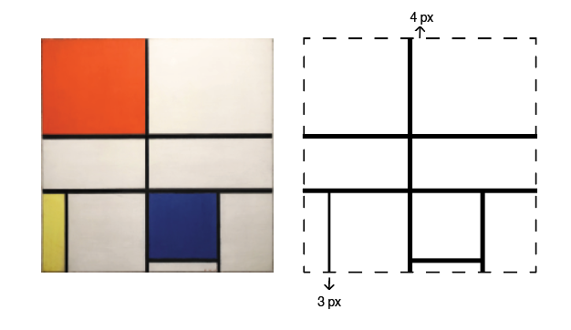

# Processo - Mondrian- Parte A 

Comecei por analisar a estrutura do quadro, e como é que cada quadrante se formava, visto que estava no islustrator reparei que algumas das linhas não eram da mesma espessura.

 