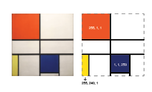
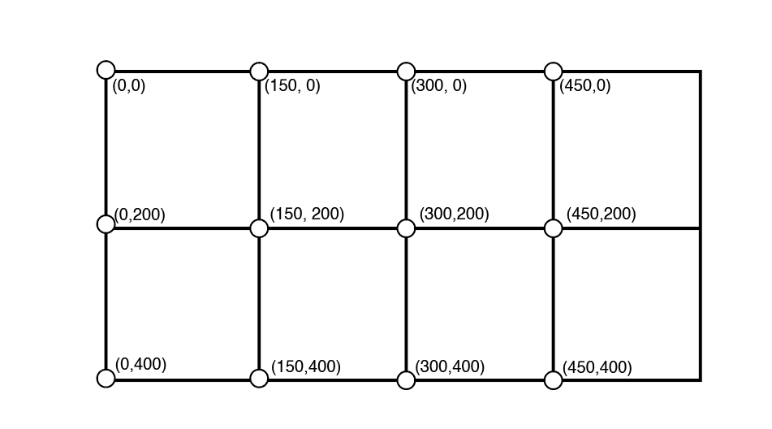

# Processo - Mondrian- Parte A 

Comecei por analisar a estrutura do quadro, e como é que cada quadrante se formava, visto que estava no islustrator reparei que algumas das linhas não eram da mesma espessura.

Vi também as cores correspondentes, e os locais onde estavam.

 *Código*
 Para a parte da construção em código basei-me num quadro de valores, ajudou-me no raciocínio das interseções e de onde por cada uma das linhas.

Quadro de valores

Na parte da de acrescentar cor no locais especifícos fui ao p5js e nas referências encontrei o rect() e reparei que podia atribuir um fill 